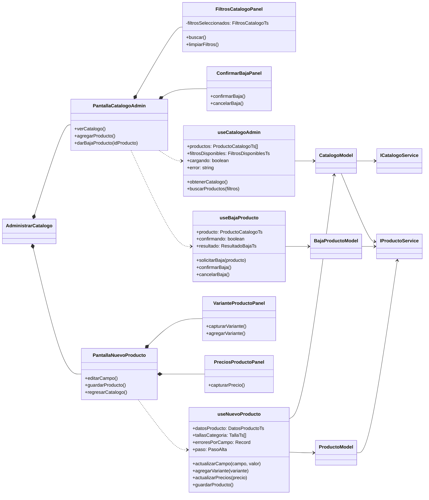

# CU Administrar catálogo

Para probar la presentación sin backend: ejecutar `npm run dev` y abrir `/dev/administrar-catalogo` en la dirección que indique Vite (normalmente `http://localhost:5173/dev/administrar-catalogo`). Esta ruta solo existe en desarrollo y usa adaptadores en memoria ubicados en `src/app/desarrollo`. Permite filtrar, registrar productos con una imagen local y dar de baja; una recarga reinicia los datos. No modifica la sesión ni los servicios reales.

Implementación React y TypeScript de las tres referencias UML proporcionadas. Los elementos «View» son componentes funcionales, los «ViewModel» son hooks y los modelos de aplicación encapsulan validación y coordinación de servicios.

## Diagrama de presentación



## Integración

El módulo exporta `AdministrarCatalogo`, que recibe implementaciones de `ICatalogoService` e `IProductoService`. Mantener estables las instancias durante el montaje. Crear los adaptadores HTTP usando el `HttpClient` existente y las rutas reales del backend. Envolver el componente en `RutaProtegida roles={['ADMIN', 'EMPLEADO']}` al registrarlo en el router. No se registró una ruta con servicios ficticios: las referencias no especifican URLs ni formatos HTTP.

Los contratos incluyen creación de variantes y precios porque el alta requiere esas operaciones además de crear el producto. `OpcionesCatalogoDTO` representa las opciones disponibles; no se necesita recuperar el archivo eliminado `FiltrosCatalogoDTO.ts`. Los DTO actuales no relacionan subcategorías con categorías, por lo que se muestran las opciones que devuelve el servicio sin inventar esa relación.

## Decisiones respecto al UML

- `DatosProductoTs.imagenes` usa `File | null` para concordar con `CrearProductoDTO` y el selector de archivos.
- Los enums se representan con objetos `as const` y tipos derivados, compatibles con `erasableSyntaxOnly` del proyecto.
- Las existencias se calculan sumando el stock de las variantes del DTO.
- El formulario presenta datos, variantes y precios en secciones de una misma página, con publicación y vista previa en una columna lateral. Conserva `PasoAlta` y los hooks del diagrama, y valida todos los campos antes del registro.
- Tras un error de alta, se conservan los datos y las operaciones confirmadas para reintentar. Si ya existe un producto remoto parcial, la edición queda bloqueada hasta completar el registro; si falló la creación inicial, los campos siguen editables. Para garantizar reintentos seguros cuando el servidor procesa una petición pero se pierde la respuesta, el backend debe proporcionar idempotencia o una operación transaccional; el cliente por sí solo no puede garantizarlo.
- Los hooks reciben dependencias; las vistas no realizan peticiones HTTP directamente.
```
View → Hook (ViewModel) → Model → interfaz de servicio → adaptador HTTP
```

## Adaptación visual a Figma

Referencia: archivo `KK4Nt5bR2DKKYERFaLJIqY`, página `144:43` (FlyRediseño · Casos de uso). Marcos consultados: catálogo `160:4099`, alta `160:4511` y baja `161:5478`.

La capa de presentación agrega `CatalogoAdminLayout` para la barra lateral y superior, sin introducir dependencias de React en el dominio o los modelos. Usa los tokens FLY, Oswald e Inter y los componentes compartidos `Boton`, `Campo`, `Chip`, `Radio`, `Aviso`, `Insignia`, `Icono` y `Dialogo`. Este último admite alineación a la izquierda conservando su valor predeterminado para las otras pantallas.

`AdministrarCatalogo` acepta opcionalmente `usuario` (nombre, rol e iniciales) y `alCerrarSesion` para integrar la identidad real. No se muestran nombres ni contadores de ejemplo en producción. La navegación a módulos todavía no implementados permanece deshabilitada. La pestaña Categorías y marcas consulta las opciones existentes en modo de lectura.

Los contratos aprobados no incluyen talla/color en los filtros, imágenes por variante, múltiples imágenes por producto, etiquetas, costo, pedidos afectados, edición ni reactivación. Estas acciones no se simulan: se mantienen los campos y operaciones disponibles. Las miniaturas y la vista previa son dinámicas; la imagen de la gorra de Figma no se usa como sustituto de imágenes reales. El único recurso estático nuevo de producción es el logotipo descargado de Figma en `public/admin/logo-fly.png`.

Se adaptan las columnas a pantallas pequeñas, con navegación desplegable y desplazamiento horizontal contenido dentro de la tabla. El formulario admite teclado, etiquetas accesibles, validación de imagen JPG/PNG/WEBP de hasta 5 MB, liberación de URLs de vista previa y mensajes de error junto a los campos. Después de guardar, regresa al catálogo con una notificación de éxito.
