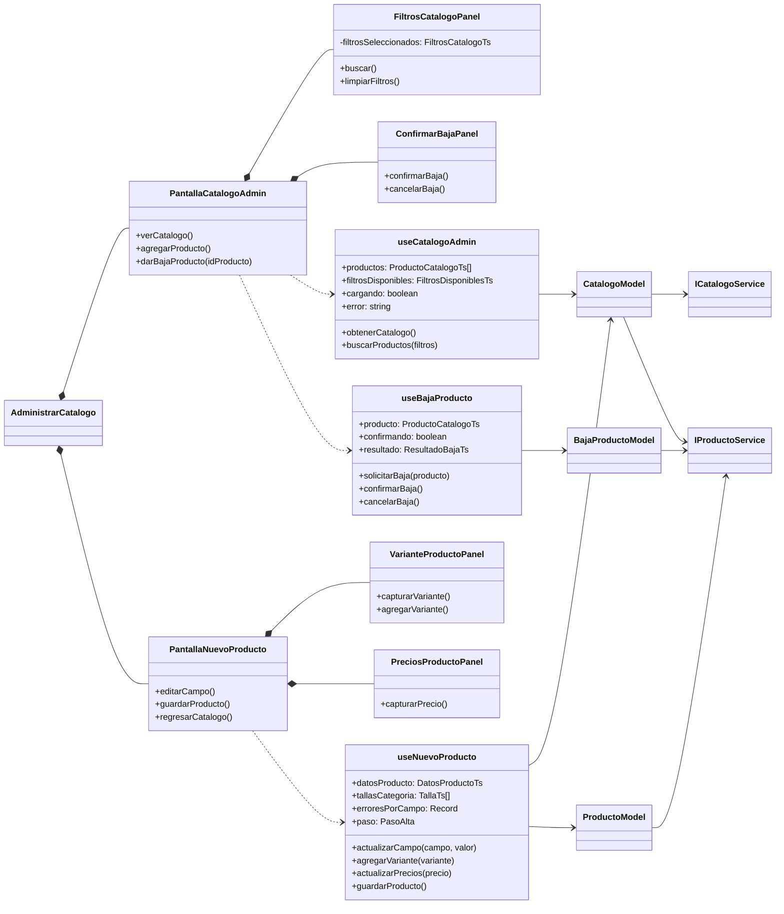

# CU Administrar catálogo

## Uso real y configuración

La ruta conectada al backend es **/admin/catalogo**, protegida para ADMIN y EMPLEADO. El enlace Administrar catálogo aparece en el encabezado para esos roles. La ruta /dev/administrar-catalogo sigue siendo una demostración en memoria: sus altas no escriben en la BD ni en Storage.

Consulta: Pantalla → hook → CatalogoModel → ProductoService/CatalogoService → API → BO → DAO. Se cargan primero productos y después opciones. Buscar exige al menos un filtro y no recarga las opciones; Limpiar consulta todos. Los IDs permanecen String, incluidos identificadores mayores que el límite seguro de JavaScript.

Alta: selecciona categoría, talla y un color exacto de la BD. Conserva archivo y vista previa local. Se envía una única petición POST multipart a /api/productos, con producto (JSON, variantes y preciosProducto) e imagen (File). El backend sube a Supabase Storage, persiste el agregado en una transacción y devuelve 201 sin cuerpo. El cliente vuelve al catálogo y lo consulta de nuevo. Un rechazo conserva el formulario editable; no hay registro parcial por peticiones separadas.

Configura VITE_API_URL según .env.example, o utiliza el proxy /api de Vite hacia localhost:8080. Las credenciales secretas y el bucket se configuran exclusivamente en el backend (ver su STORAGE.md). Si se pierde la respuesta después de guardar, consulta el catálogo antes de repetir: no se puede garantizar el resultado de una petición interrumpida.

La baja de la ruta real queda pendiente de su flujo aprobado; el botón permanece deshabilitado. La demostración conserva su baja local.


Para probar la presentación sin backend: ejecutar `npm run dev` y abrir `/dev/administrar-catalogo` en la dirección que indique Vite (normalmente `http://localhost:5173/dev/administrar-catalogo`). Esta ruta solo existe en desarrollo y usa adaptadores en memoria ubicados en `src/app/desarrollo`. Permite filtrar, registrar productos con una imagen local y dar de baja; una recarga reinicia los datos. No modifica la sesión ni los servicios reales.

Implementación React y TypeScript de las tres referencias UML proporcionadas. Los elementos «View» son componentes funcionales, los «ViewModel» son hooks y los modelos de aplicación encapsulan validación y coordinación de servicios.

## Diagrama de presentación



## Integración

El módulo exporta `AdministrarCatalogo` para la demostración. La ruta real compone las vistas con los adaptadores HTTP y modelos del contenedor, usando el `HttpClient` compartido y `RutaProtegida`. Se preservan los módulos de ventas y pedidos.

El contrato de alta incluye variantes y precios en la misma solicitud; no utiliza endpoints separados. `OpcionesCatalogoDTO` representa las opciones disponibles; no se necesita recuperar el archivo eliminado `FiltrosCatalogoDTO.ts`. Los DTO actuales no relacionan subcategorías con categorías, por lo que se muestran las opciones que devuelve el servicio sin inventar esa relación.

## Decisiones respecto al UML

- `DatosProductoTs.imagenes` usa `File | null` para concordar con `CrearProductoDTO` y el selector de archivos.
- Los enums se representan con objetos `as const` y tipos derivados, compatibles con `erasableSyntaxOnly` del proyecto.
- Las existencias se calculan sumando el stock de las variantes del DTO.
- El formulario presenta datos, variantes y precios en secciones de una misma página, con publicación y vista previa en una columna lateral. Conserva `PasoAlta` y los hooks del diagrama, y valida todos los campos antes del registro.
- Tras un rechazo del alta se conservan los datos editables. El backend guarda el agregado en una transacción y compensa la imagen ante rollback. Una respuesta de red perdida requiere consultar el catálogo antes de reintentar.
- Los hooks reciben dependencias; las vistas no realizan peticiones HTTP directamente.
```
View → Hook (ViewModel) → Model → interfaz de servicio → adaptador HTTP
```

## Adaptación visual a Figma

Referencia: archivo `KK4Nt5bR2DKKYERFaLJIqY`, página `144:43` (FlyRediseño · Casos de uso). Marcos consultados: catálogo `160:4099`, alta `160:4511` y baja `161:5478`.

La capa de presentación agrega `CatalogoAdminLayout` para la barra lateral y superior, sin introducir dependencias de React en el dominio o los modelos. Usa los tokens FLY, Oswald e Inter y los componentes compartidos `Boton`, `Campo`, `Chip`, `Radio`, `Aviso`, `Insignia`, `Icono` y `Dialogo`. Este último admite alineación a la izquierda conservando su valor predeterminado para las otras pantallas.

`AdministrarCatalogo` acepta opcionalmente `usuario` (nombre, rol e iniciales) y `alCerrarSesion` para integrar la identidad real. No se muestran nombres ni contadores de ejemplo en producción. La navegación a módulos todavía no implementados permanece deshabilitada. La pestaña Categorías y marcas consulta las opciones existentes en modo de lectura.

Los contratos aprobados no incluyen talla/color en los filtros, imágenes por variante, múltiples imágenes por producto, etiquetas, costo, pedidos afectados, edición ni reactivación. Estas acciones no se simulan: se mantienen los campos y operaciones disponibles. Las miniaturas y la vista previa son dinámicas; la imagen de la gorra de Figma no se usa como sustituto de imágenes reales. El único recurso estático nuevo de producción es el logotipo descargado de Figma en `public/admin/logo-fly.png`.

Se adaptan las columnas a pantallas pequeñas, con navegación desplegable y desplazamiento horizontal contenido dentro de la tabla. El formulario admite teclado, etiquetas accesibles, validación de imagen JPG/PNG/WEBP de hasta 5 MB, liberación de URLs de vista previa y mensajes de error junto a los campos. Después de guardar, regresa al catálogo con una notificación de éxito.
